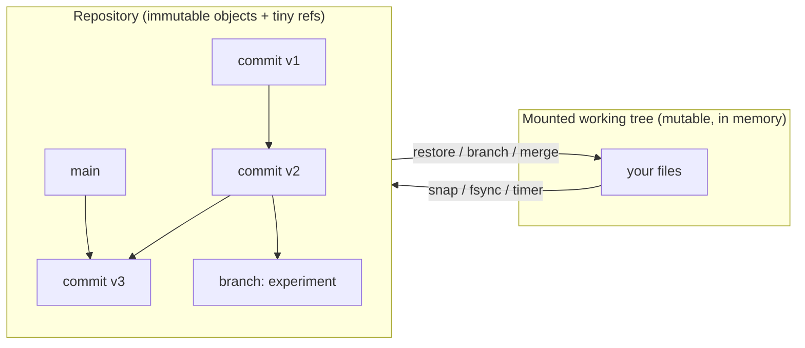

# TimeFS

A userspace filesystem (FUSE / libfuse3) with **built-in time travel**: every change can be
checkpointed into an immutable, content-addressed, copy-on-write history that you can
inspect, branch, merge and roll back — without copying data.

> **Status: early development.** The design is documented; implementation is in
> progress. See the [roadmap](docs/roadmap.md) for what works today. Nothing in this
> README is claimed unless it is implemented and tested.

## Idea in one picture



* **Snapshots are O(1)**: a snapshot is a 32-byte hash. Unchanged data is shared.
* **Branch a directory**, change each branch independently, **merge** them back.
* **Crash recovery** by construction: objects are written before refs point to them.
* **Dedupe and integrity** for free: data is named by its BLAKE3 hash.

Research question: *how cheaply can a general-purpose filesystem support snapshots,
branching and recovery?* — answered with measurements in [`docs/benchmarks.md`](docs/benchmarks.md).

## Documentation

| Document | What's in it |
|----------|--------------|
| [docs/why.md](docs/why.md) | Motivation, what it does better, non-goals, prior art |
| [docs/architecture.md](docs/architecture.md) | Components, data model, write path, crash recovery, merge (Mermaid diagrams) |
| [docs/format.md](docs/format.md) | Canonical on-disk format v1 |
| [docs/adr/](docs/adr/) | Architecture decision records with rejected alternatives |
| [docs/testing.md](docs/testing.md) | Test strategy |
| [docs/benchmarks.md](docs/benchmarks.md) | Benchmark questions, methodology, results |
| [docs/roadmap.md](docs/roadmap.md) | Milestones and progress log |
| [AGENTS.md](AGENTS.md) | Contributor / coding-agent guide |

## Requirements

* Linux with FUSE (`/dev/fuse`), `fusermount3`
* `libfuse3` development files and `pkg-config` (Debian/Ubuntu: `libfuse3-dev fuse3 pkg-config`; Arch: `fuse3`)
* Rust (stable; see `rust-toolchain.toml`)

## Build and test

```sh
cargo build --release
cargo test --workspace
```

## Layout

```text
crates/timefs-core   versioning engine (no FUSE): objects, repo, worktree, merge, gc
crates/timefs-fuse   FUSE adapter and control socket
crates/timefs-cli    the `timefs` binary
docs/                architecture, format, ADRs, benchmarks, roadmap
scripts/             integration and benchmark scripts
```

## License

MIT — see [LICENSE](LICENSE).
