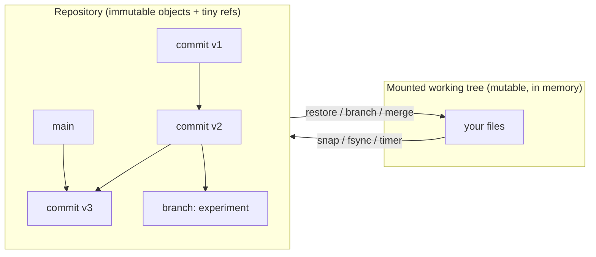

# TimeFS

A userspace filesystem (FUSE / libfuse3) with **built-in time travel**: changes are checkpointed
into an immutable, content-addressed, copy-on-write history that you can inspect, branch, merge and roll back.

* **Status:** milestones M0 to M5 are done (core, repository, worktree, FUSE mount, checkpoints with crash recovery, control socket, merge, GC, offline snap/checkout/reset).
* M6 (benchmarks, optimisation) is in progress; M7 (hardening) has not started. See [roadmap](docs/roadmap.md).

## Idea in one picture



## How it works

* Data is stored as immutable objects (Blob, File, Tree, Commit) named by their BLAKE3 hash.
* Only refs (`refs/heads/*`, `refs/wip/*`, `HEAD`) are mutable.
* A snapshot is a commit: a root tree hash plus parents, so unchanged data is shared.
* A mount is a mutable in-memory overlay (`WorkTree`) on a base commit; only dirty paths are written on commit.
* Checkpoints (`fsync`, timer, size threshold, unmount) write `refs/wip/<branch>`; the next mount recovers from it.
* Objects are written before any ref points at them, so a crash leaves only harmless garbage.
* By default objects and refs live in one append-only log (the pack store): one `fdatasync`
  makes a checkpoint durable, and recovery trims a torn tail without ever keeping a ref to
  a lost object.
* Branching is a new ref; merge is a 3-way tree merge with explicit conflicts.
* `snap`, `checkpoint` and `status` talk to the running mount over a Unix socket in the repo.

## Quick start

```sh
cargo build --release          # binary: target/release/timefs
export TIMEFS_REPO=~/my-repo   # or pass --repo <dir> to every command

timefs init                    # pack store (default); --store loose for one file per object
mkdir ~/mnt
timefs mount ~/mnt &           # runs until unmounted (fusermount3 -u ~/mnt)
echo hello > ~/mnt/a.txt
timefs snap -m "first"         # snapshot the live mount
timefs checkpoint              # persist without committing to the branch
timefs status                  # state of the running mount
fusermount3 -u ~/mnt

timefs log                     # history
timefs ls HEAD                 # list a directory in a revision
timefs cat HEAD a.txt          # print a file from a revision
timefs diff HEAD~1 HEAD        # what changed between revisions
timefs branch try-it           # create a branch (omit name to list, -d to delete)
timefs checkout try-it         # switch branch (repo unmounted)
timefs merge main              # 3-way merge; add --resolve ours|theirs on conflicts
timefs reset <rev>             # move the branch to a revision
timefs gc --dry-run            # then: timefs gc [--grace-secs N]
timefs fsck                    # verify every object and ref
timefs stats                   # size and dedupe statistics
```

* Offline helpers: `timefs import <dir> [-m msg] [--chunker fixed:64K|cdc:AVG]` snapshots a host directory; `timefs export <rev> <dest>` writes a revision into an empty directory.
* Mount options: `--branch`, `--checkpoint-interval SECS` (default 5, 0 disables), `--flush-threshold-mib`, `--attr-ttl-ms`, `--block-size`, `--threads`, `--allow-other`.
* Global: `--repo <dir>` / `TIMEFS_REPO` (default `.timefs-repo`).
* `merge`, `checkout`, `reset` and `gc` refuse to run while the repo is mounted.

## Current limitations

* No hard links, no extended attributes.
* GC is whole-repo stop-the-world and needs the repo unmounted.
* `merge`, `checkout`, `reset`, `gc` need the repo unmounted.
* Inodes of touched nodes stay in memory for the life of the mount.
* No compression.
* Files are capped at 64 GiB (flat extent lists; extent pages are proposed in ADR-0009).
* Single node; a pack repository has one writing process at a time (the mount).
* No automatic migration between the loose and pack layouts yet.

## Documentation

| Document | What's in it |
|----------|--------------|
| [docs/why.md](docs/why.md) | Motivation, what it does better, non-goals, prior art |
| [docs/architecture.md](docs/architecture.md) | Components, data model, write path, crash recovery, merge (Mermaid diagrams) |
| [docs/format.md](docs/format.md) | Canonical on-disk format v1 |
| [docs/adr/](docs/adr/) | Architecture decision records with rejected alternatives |
| [docs/testing.md](docs/testing.md) | Test strategy |
| [docs/benchmarks.md](docs/benchmarks.md) | Benchmark questions, methodology, results |
| [docs/roadmap.md](docs/roadmap.md) | Milestones and progress log |
| [AGENTS.md](AGENTS.md) | Contributor / coding-agent guide |

## Requirements

* Linux with FUSE (`/dev/fuse`) and `fusermount3`.
* `libfuse3` dev files and `pkg-config` (Debian/Ubuntu: `libfuse3-dev fuse3 pkg-config`; Arch: `fuse3`).
* Rust stable (see `rust-toolchain.toml`).

## Build and test

```sh
cargo build --release
cargo test --workspace
```

## Layout

```text
crates/timefs-core   versioning engine (no FUSE): objects, repo, worktree, merge, gc
crates/timefs-fuse   FUSE adapter, checkpointer, control socket
crates/timefs-cli    the `timefs` binary
crates/timefs-bench  benchmark harness
docs/                architecture, format, ADRs, benchmarks, roadmap
scripts/             integration and benchmark scripts
```

## License

MIT, see [LICENSE](LICENSE).
