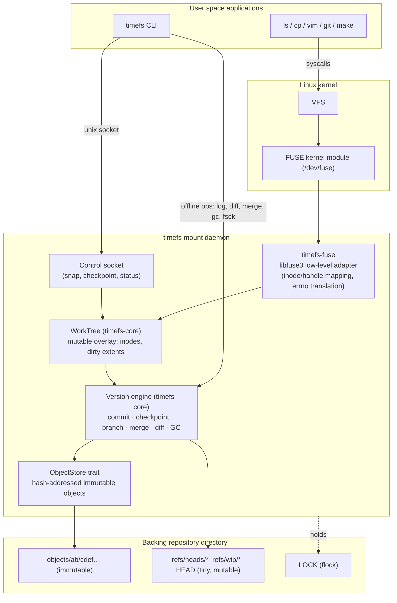
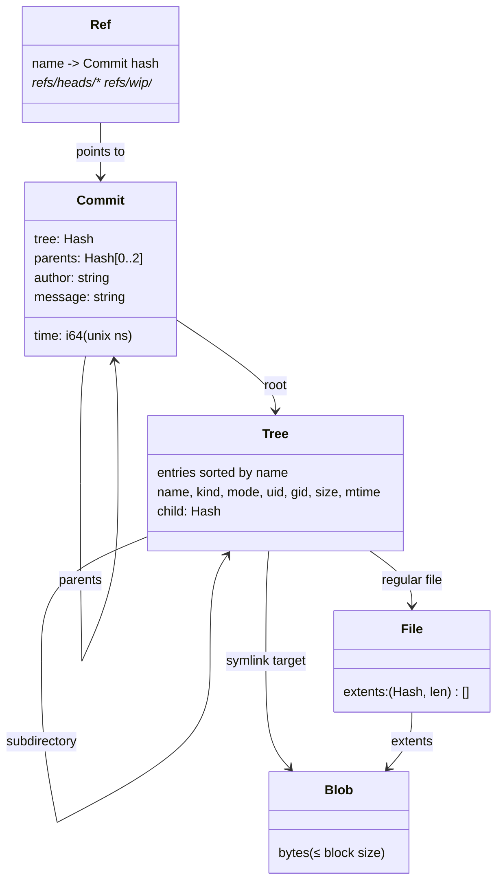
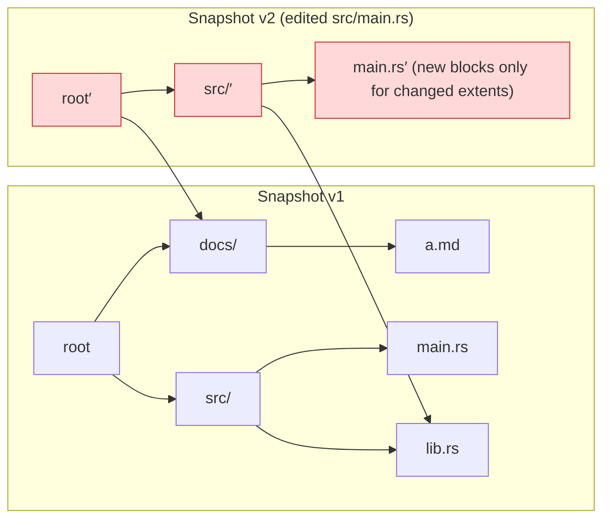
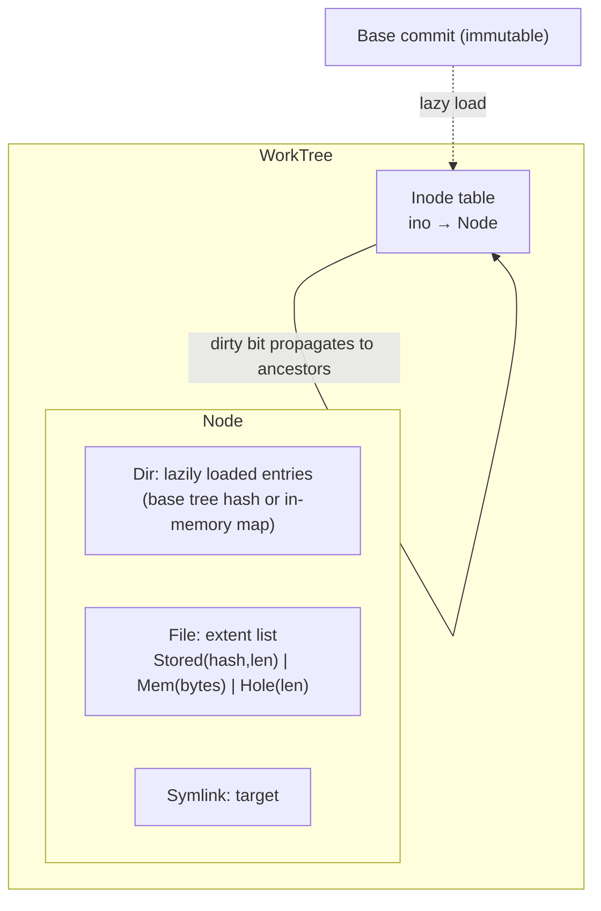
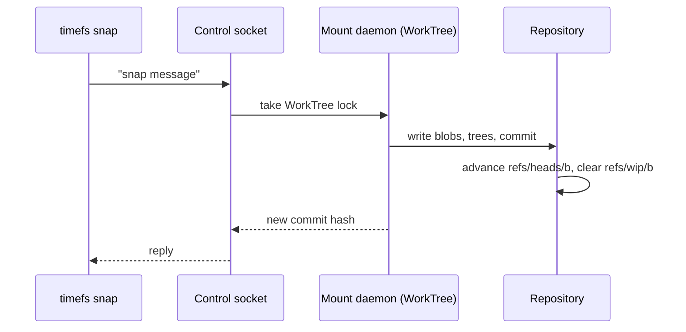
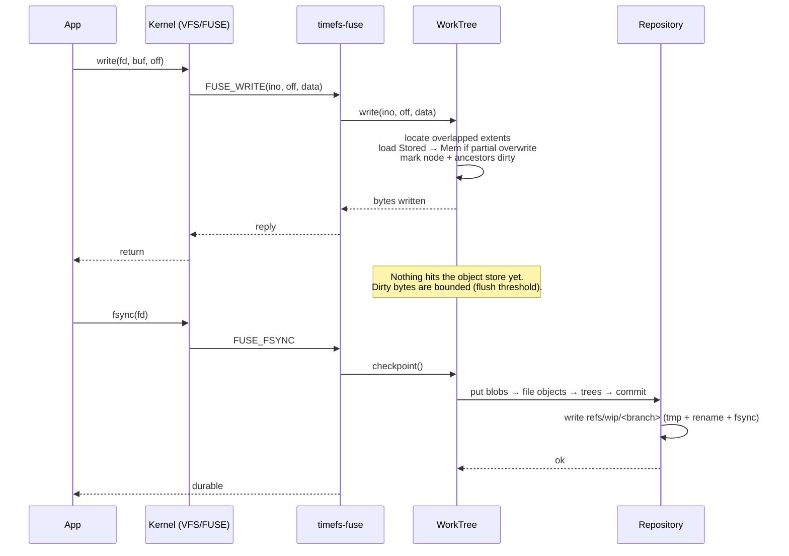
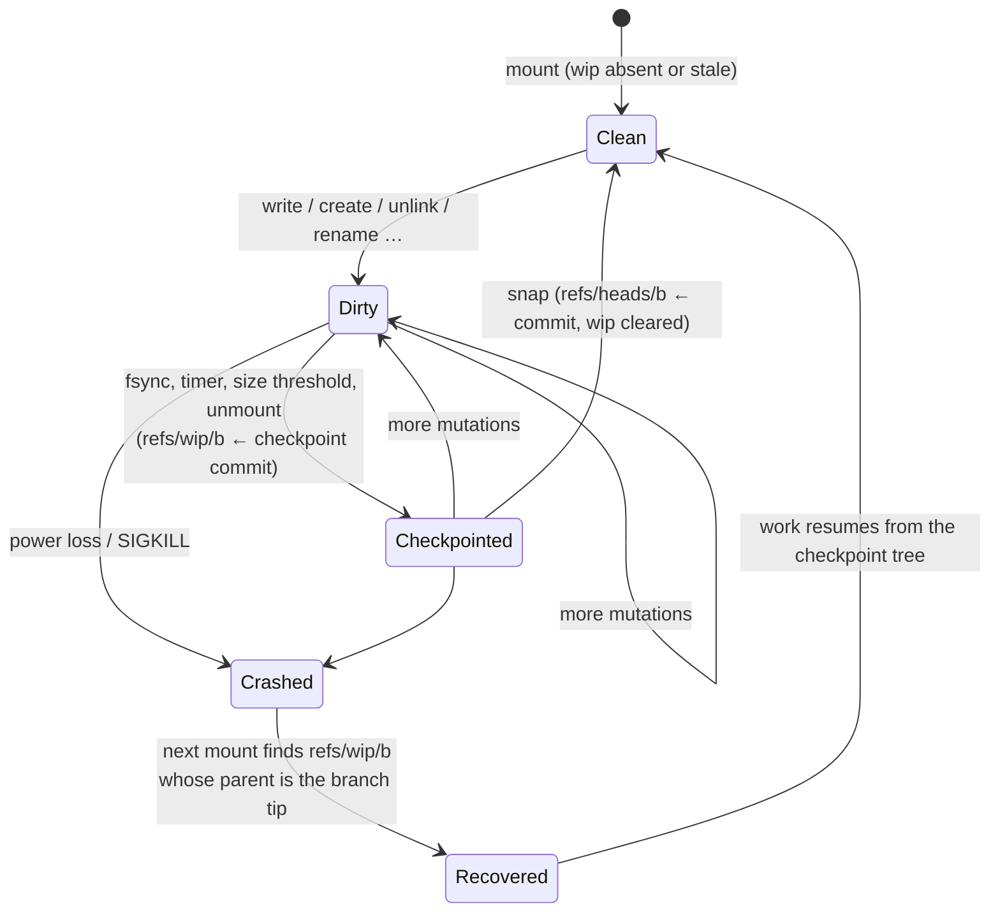
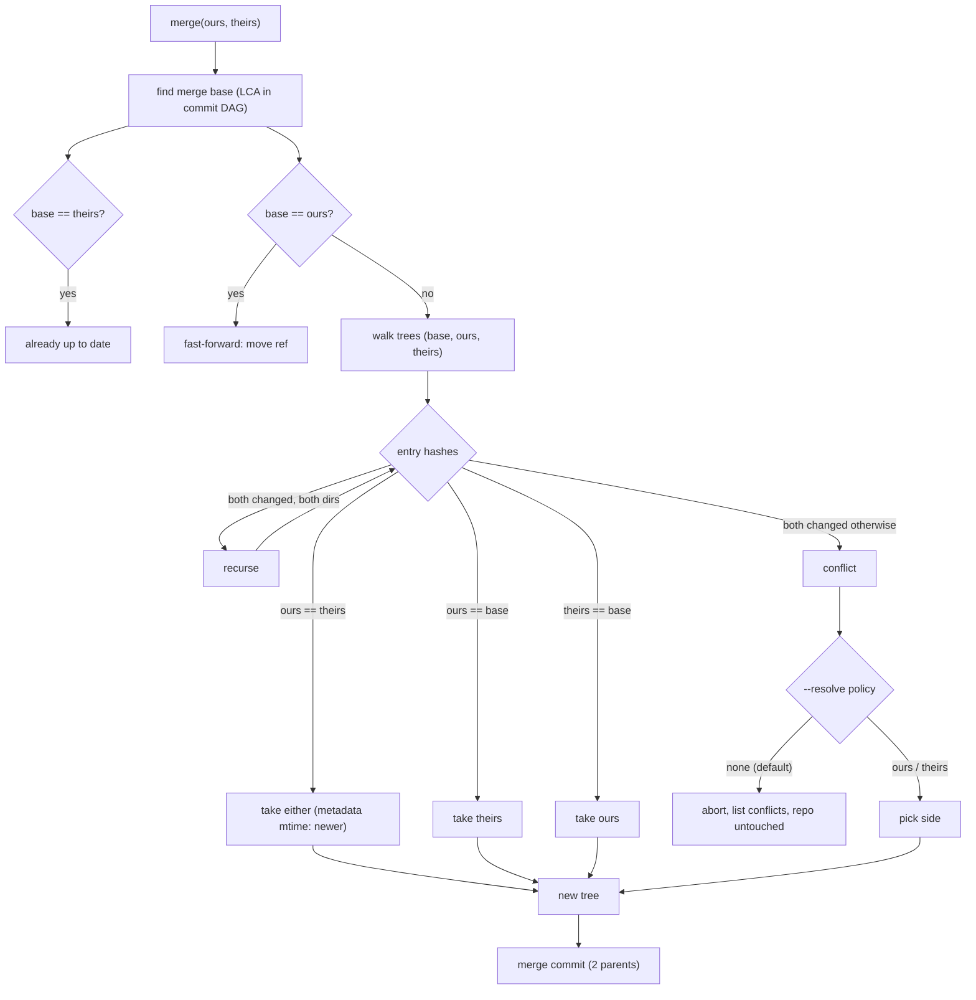

# TimeFS architecture

* Everything in sections 1 to 9 is implemented (roadmap milestones M0 to M5 are done).
* In progress: M6 benchmarks and optimisation. See the [roadmap](roadmap.md).

## 1. System overview



Design rule: **everything below the FUSE adapter is FUSE-agnostic.**

* `timefs-core` holds objects, repository, WorkTree, merge and GC; tested without mounting.
* `timefs-fuse` is a translation layer (about one function per FUSE opcode).

### Crates

| Crate | Role |
|-------|------|
| `timefs-core` | Hashing, canonical codec, loose object store, chunking, trees/commits, refs, repository, `WorkTree`, diff, merge, GC, fsck |
| `timefs-fuse` | `fuser` (libfuse3) `Filesystem` over `WorkTree`, checkpointer thread, control socket server and client |
| `timefs-cli`  | `timefs` binary: `init import export log ls cat diff branch checkout reset merge gc fsck stats mount snap checkpoint status` |
| `timefs-bench` | Benchmark harness (scenarios: snapshot, branch, merge, dedupe, store, write amplification) |

## 2. Data model

Everything persistent is one of four **immutable objects**, named by the BLAKE3 hash of
its canonical encoding, plus a handful of **mutable refs**.



| Object | Contents |
|--------|----------|
| Blob | Block of file data (default 64 KiB) or symlink target; sizes live in the extent list, so variable-size chunking needs no format change |
| File | Ordered extent list `(blob hash, length)`; the file is the concatenation |
| Tree | Directory entries sorted by name, each with POSIX metadata and target hash; metadata lives in the parent entry, so `stat` never loads file content |
| Commit | Root tree, parents, time, author, message |
| Ref | The only mutable state: `refs/heads/<b>` (branch tip), `refs/wip/<b>` (crash-recovery checkpoint, see section 5) |

* Encoding: [`format.md`](format.md). Rationale: [ADR-0002](adr/0002-content-addressed-merkle-objects.md).

### Copy-on-write by path copying

* Changing one file rewrites only the objects on the path from that file to the root.
* Every other object is shared between versions.



* Snapshot cost after editing *k* files at depth *d*: O(k·d) new tree objects plus changed blocks.
* Independent of total tree size.

## 3. Components

### 3.1 Object store (implemented)

```text
put(kind, bytes) -> Hash       // idempotent; writes tmp file + rename; dedupes by existence
get(hash)        -> (kind, bytes)
has(hash)        -> bool
iter()           -> all hashes (for GC / fsck)
delete(hash)
```

* Backend: **loose objects** (`objects/<2 hex>/<62 hex>`), written atomically, reads verified against the hash.
* A packed backend is only considered if benchmarks show loose-object overhead dominates ([ADR-0003](adr/0003-loose-objects-first.md)).

### 3.2 Repository (implemented)

* Opens or creates a repo directory; owns the object store and refs.
* Takes the `LOCK` (`flock`) for exclusive operations.
* Resolves revisions (`HEAD`, branch names, `rev~N`), creates commits, walks history, computes merge bases.
* Runs GC and fsck.

### 3.3 WorkTree, the mutable overlay (implemented)

* The live, writable view of one branch: FUSE needs cheap in-place mutation, the repository is immutable.



* **Lazy loading:** a directory's `Tree` is read when first listed, file extents when first opened; mount cost does not grow with tree size.
* **Extents:** `Stored` (blob in the repo, fetched on demand), `Mem` (modified bytes), `Hole` (zeros, shared all-zero blob).
* **Partial writes:** `write()` touches only overlapped extents.
* **Dirty tracking:** a mutation marks the node and its ancestors; commit walks only dirty paths.
* **Memory:** inodes of touched nodes stay in memory for the life of the mount.
* **Hard links:** not supported (`link()` is not implemented); dedupe covers the space benefit ([ADR-0005](adr/0005-extent-based-files.md)).

### 3.4 Version engine (implemented)

| Operation | What happens | Cost |
|-----------|--------------|------|
| **checkpoint** | Flush dirty extents → blobs, write dirty trees bottom-up, write a commit parented on the branch tip, atomically point `refs/wip/<b>` at it | O(dirty bytes + dirty paths) |
| **snapshot (`snap`)** | checkpoint, then advance `refs/heads/<b>` and clear the wip ref (also works offline on an unmounted repo) | same + one ref rename |
| **branch** | write a new ref | O(1) |
| **checkout / reset** | switch branch, or move the branch to another revision (repo unmounted) | O(1) (+ lazy loads) |
| **diff** | recursive tree compare, skipping equal hashes | O(changed paths) |
| **merge** | 3-way tree merge using the merge base | O(changed paths) |
| **GC** | mark from all refs, sweep unreachable older than a grace period | O(objects) |
| **fsck** | rehash every object, check reachability and ref validity | O(bytes) |

### 3.5 FUSE adapter, `timefs-fuse` (implemented)

* Implements `fuser::Filesystem` (libfuse3) with the low-level inode API: `lookup getattr setattr readlink mknod mkdir unlink rmdir symlink rename open read write flush release fsync opendir readdir releasedir fsyncdir statfs create access forget`.
* `mknod` accepts regular files only (no device nodes or fifos).
* Keeps open-file handles, translates `WorkTree` errors to `errno`, holds no versioning logic.
* The `WorkTree` sits behind one lock because `fuser`'s trait takes `&self`; finer locking is a benchmark-driven option.
* A checkpointer thread runs the periodic checkpoint (`--checkpoint-interval`).

### 3.6 Control plane (implemented)

* Unix socket `<repo>/timefs.sock`, newline-delimited text protocol.
* Each request is one line of at most 4 KiB; connections get 2 s read and write timeouts, so an idle client cannot block other requests or unmount.
* `timefs mount` exits non-zero if the final checkpoint fails, and only then skips the "changes checkpointed" message.
* Requests: `snap [message]`, `checkpoint`, `status`.
* Offline commands (`log`, `ls`, `cat`, `diff`, `branch`, `fsck`, `stats`) work directly on the repository.
* `merge`, `checkout`, `reset`, `gc` take the repo `LOCK` and fail with "the repository is mounted; unmount it first" if a daemon holds it ([ADR-0007](adr/0007-control-plane.md)).



## 4. Life of a write



## 5. Durability and crash recovery

Invariant: **an object is fully written and durable before any ref points to it.**
A crash can therefore leave unreferenced objects (harmless; GC reclaims them) but never a
ref to a missing or torn object.



* Checkpoint commits are parented on the **branch tip**, so repeated checkpoints do not accumulate history.
* Un-checkpointed data is lost on a crash, like any buffered filesystem without `fsync`.
* The loss window is bounded by `fsync`, `--checkpoint-interval` (default 5 s) and `--flush-threshold-mib`.
* A stale wip ref (parent is not the branch tip) is ignored on mount.
* Ref updates: write temp, `fsync`, `rename`, `fsync(dir)`.

## 6. Merge



* Equal subtree hashes short-circuit the walk: cost follows changed paths, not tree size.
* Conflicts are reported per path (add/add, modify/modify, modify/delete, file/dir).
* CLI: `timefs merge <rev> [--resolve ours|theirs]`, repository unmounted.
* Line-level text merge is a possible later extension ([ADR-0006](adr/0006-merge-semantics.md)).

## 7. Garbage collection

* Mark: from every ref (`heads`, `wip`) walk commits, trees, files, blobs.
* Sweep: delete unmarked objects older than the grace period (`--grace-secs`, default 3600).
* `--dry-run` reports without deleting.
* Requires the repo unmounted ([ADR-0008](adr/0008-stop-the-world-gc.md)).

## 8. Concurrency model

* One daemon per repository (`flock` on `LOCK`).
* A single mutex guards the `WorkTree`; FUSE worker threads (`--threads`, default 1) serialise on it.
* Contention is measured before any finer locking is added.
* Object store is safe for concurrent use (atomic create-by-rename; identical puts are benign).

## 9. Failure modes and how they are handled

| Failure | Behaviour |
|---------|-----------|
| Crash mid-object-write | Temp file left behind; ignored and swept by GC; ref never points at it |
| Crash mid-ref-update | `rename` is atomic: either old or new ref value |
| Torn / bit-rotted object | Detected on read (hash mismatch) → `EIO`; `fsck` reports it |
| Disk full | `put` fails → FUSE op returns `ENOSPC`/`EIO`; previous refs intact |
| Two daemons on one repo | Second fails to take `LOCK` and exits |
| Daemon killed with dirty data | Recovered from last `refs/wip` checkpoint on next mount |

## 10. Known limitations (v1)

* No hard links, no extended attributes, no ACLs, no `mmap` write-sharing guarantees beyond FUSE defaults.
* Single node, single writer.
* No encryption or compression.
* Whole-repo GC is stop-the-world; `merge`, `checkout`, `reset`, `gc` need the repo unmounted.
* Inodes of touched nodes stay in memory.
* Flat extent lists; very large files would want a two-level extent tree.
* See the [roadmap](roadmap.md) for planned work and the [ADRs](adr/) for reasoning.
