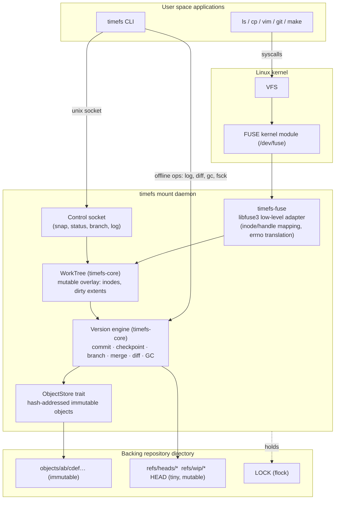
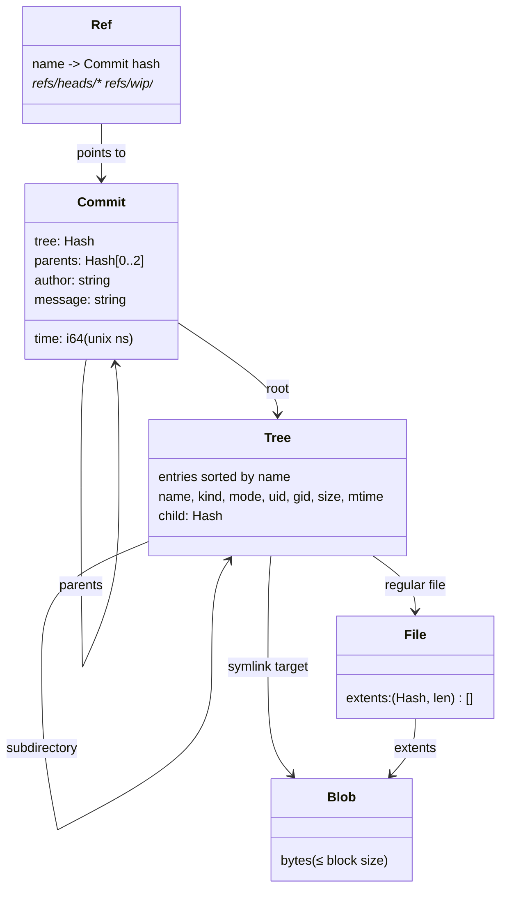
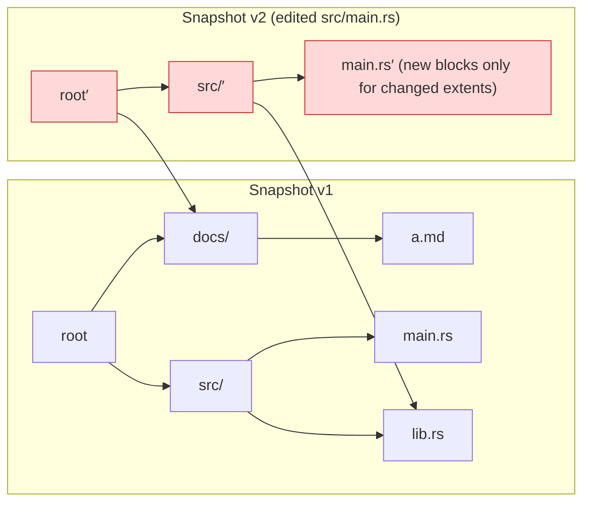
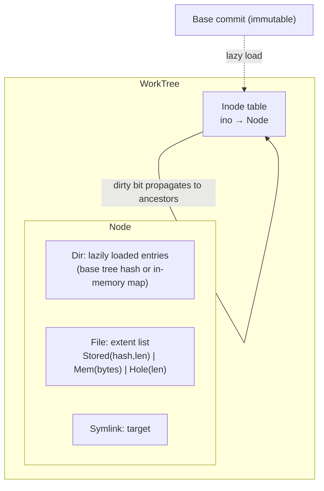
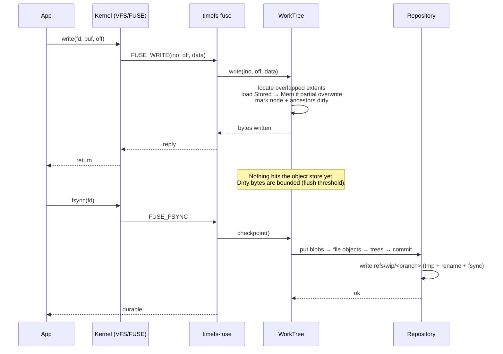
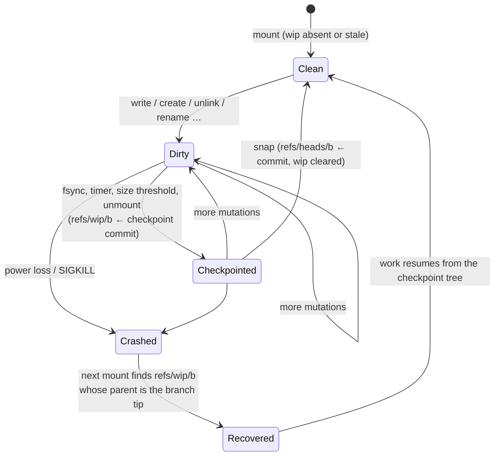
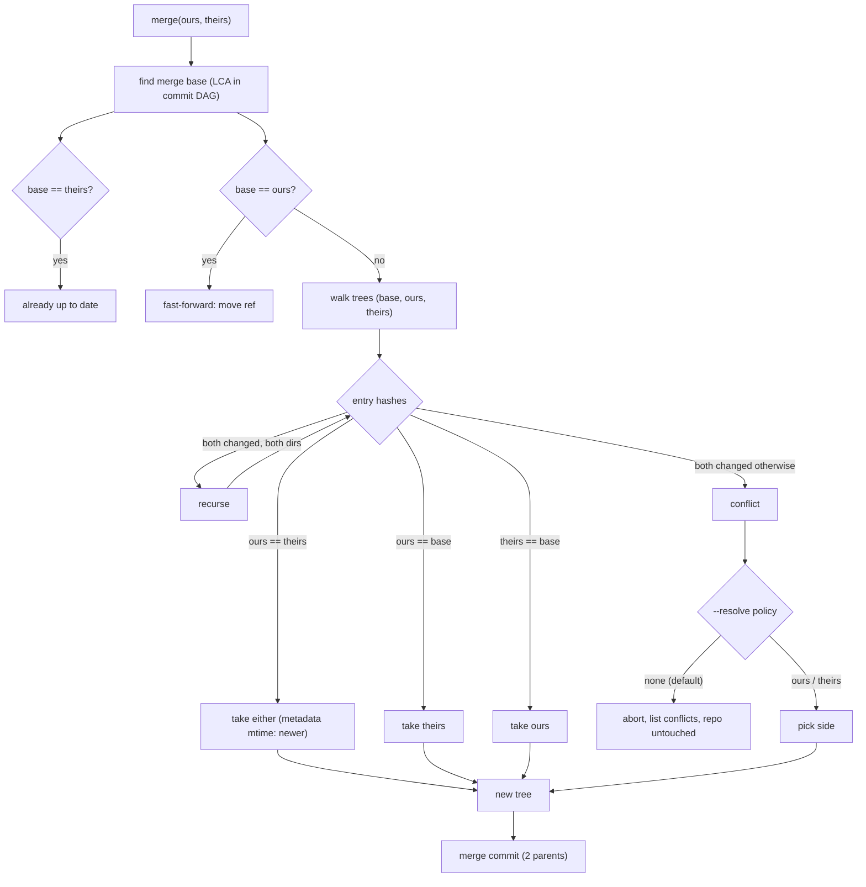

# TimeFS architecture

> Status legend used in this document: ✅ implemented · 🚧 in progress · 📝 designed, not yet built.
> The [roadmap](roadmap.md) tracks the current state; this document describes the target design.

## 1. System overview



Design rule: **everything below the FUSE adapter is FUSE-agnostic.** `timefs-core`
contains the object model, the repository, the mutable working tree and the merge/GC
algorithms, and is exercised by unit, property and crash-injection tests without ever
mounting anything. `timefs-fuse` is a translation layer (~one function per FUSE opcode).

### Crates

| Crate | Role |
|-------|------|
| `timefs-core` | Hashing, canonical codec, object store, chunking, trees/commits, refs, repository, `WorkTree`, diff, merge, GC, fsck |
| `timefs-fuse` | `fuser` (libfuse3) `Filesystem` implementation over `WorkTree`; control socket server |
| `timefs-cli`  | `timefs` binary: `init`, `mount`, `snap`, `log`, `branch`, `diff`, `merge`, `restore`, `gc`, `fsck`, `stats` |

## 2. Data model

Everything persistent is one of four **immutable objects**, named by the BLAKE3 hash of
its canonical encoding, plus a handful of **mutable refs**.



* **Blob** — a block of file data (default 64 KiB; sizes are recorded in the extent list so
  variable-size chunking is representable without a format change).
* **File** — an ordered *extent list* `(blob hash, length)`; the file is the concatenation.
* **Tree** — a directory: entries sorted by name; each entry carries POSIX metadata and the
  hash of its target. Metadata lives in the *parent's* entry, so `stat` never needs to load
  a file's content.
* **Commit** — root tree, parent(s), time, author, message.
* **Ref** — the only mutable state. `refs/heads/<branch>` is a branch tip;
  `refs/wip/<branch>` is the crash-recovery checkpoint for a mounted branch (§5).

Encoding details: [`format.md`](format.md). Rationale: [ADR-0002](adr/0002-content-addressed-merkle-objects.md).

### Copy-on-write by path copying

Changing one file rewrites only the objects on the path from that file to the root;
every other object is shared between versions.



Cost of a snapshot after editing *k* files at depth *d* is O(k·d) new tree objects plus the
changed blocks — independent of total tree size.

## 3. Components

### 3.1 Object store (`ObjectStore` trait) ✅/📝

```text
put(kind, bytes) -> Hash       // idempotent; writes tmp file + rename; dedupes by existence
get(hash)        -> (kind, bytes)
has(hash)        -> bool
iter()           -> all hashes (for GC / fsck)
delete(hash)
```

v1 backend: **loose objects** (`objects/<2 hex>/<62 hex>`), written atomically. A *packed*
append-only backend is planned **only if benchmarks show loose-object overhead dominates**
([ADR-0003](adr/0003-loose-objects-first.md)).

### 3.2 Repository ✅/📝

Opens/creates a repo directory, owns the object store and refs, takes the `LOCK`
(`flock`) for exclusive operations, resolves `HEAD`, creates commits, walks history,
computes merge bases, and runs GC/fsck.

### 3.3 WorkTree (the mutable overlay) ✅/📝

The live, writable view of one branch. This is the heart of the design: FUSE needs cheap
in-place mutation, while the repository is immutable.



* **Lazy loading.** A directory's `Tree` object is read the first time it is listed; file
  extents are read the first time a file is opened. Mounting a million-file tree is O(1).
* **Extents.** A file is a list of extents: `Stored` (a blob in the repo, fetched on
  demand), `Mem` (modified bytes), `Hole` (zeros; materialised as one shared all-zero blob).
  A `write()` touches only the extents it overlaps — random writes do not rewrite the file.
* **Dirty tracking.** Any mutation marks the node and all its ancestors dirty. Unmodified
  subtrees keep their hash, so committing walks *only dirty paths*.
* **Hard links** are not supported in v1 (`link()` returns `EPERM`/`ENOTSUP`); data-level
  dedupe makes them unnecessary for space savings. See [ADR-0005](adr/0005-extent-based-files.md).

### 3.4 Version engine ✅/📝

| Operation | What happens | Cost |
|-----------|--------------|------|
| **checkpoint** | Flush dirty extents → blobs, write dirty trees bottom-up, write a commit parented on the branch tip, atomically point `refs/wip/<b>` at it | O(dirty bytes + dirty paths) |
| **snapshot (`snap`)** | checkpoint, then advance `refs/heads/<b>` and clear the wip ref | same + one ref rename |
| **branch** | write a new ref | O(1) |
| **restore / checkout** | point a working tree at another commit | O(1) (+ lazy loads) |
| **diff** | recursive tree compare, skipping equal hashes | O(changed paths) |
| **merge** | 3-way tree merge using the merge base | O(changed paths) |
| **GC** | mark from all refs, sweep unreachable older than a grace period | O(objects) |
| **fsck** | rehash every object, check reachability and ref validity | O(bytes) |

### 3.5 FUSE adapter (`timefs-fuse`) 🚧

Implements `fuser::Filesystem` (libfuse3 mount path) with the low-level, inode-based API:
`lookup getattr setattr readlink mknod mkdir unlink rmdir symlink rename open read write
flush release fsync opendir readdir releasedir fsyncdir statfs create access forget`.
The adapter keeps open-file handles, translates `WorkTree` errors to `errno`, and holds no
versioning logic. Because `fuser`'s trait takes `&self`, the `WorkTree` lives behind a
lock (coarse-grained in v1; finer-grained locking is a benchmark-driven optimisation).

### 3.6 Control plane 📝

A Unix socket in the repo directory (line-based protocol) lets the CLI talk to a running
daemon: `snap`, `status`, `branch`, `log`. Offline commands (`log`, `diff`, `gc`, `fsck`,
`stats`, `branch`) operate directly on the repository; the ones that must not race with a
live working tree (`gc`, `fsck --repair`, `checkout`, `merge`) take the repo `LOCK` and
fail with a clear message if a daemon holds it ([ADR-0007](adr/0007-control-plane.md)).

## 4. Life of a write



## 5. Durability and crash recovery

Invariant: **an object is fully written and durable before any ref points to it.**
A crash can therefore leave unreferenced objects (harmless; GC reclaims them) but never a
ref to a missing or torn object.



* Checkpoint commits are parented on the **branch tip** (not on the previous checkpoint),
  so repeated checkpoints do not accumulate history; only the newest one stays reachable.
* Data written but not checkpointed when the process dies is lost — the same contract as
  any page-cache-buffered filesystem without `fsync`. `fsync`, a periodic timer
  (`--checkpoint-interval`), and a dirty-bytes threshold bound the loss window.
* Ref updates use write-temp → `fsync` → `rename` → `fsync(dir)`.

## 6. Merge



Equal subtree hashes short-circuit the walk, so cost is proportional to the number of
*changed* paths, not tree size. v1 reports conflicts per path (add/add, modify/modify,
modify/delete, file/dir); line-level text merging is a possible later extension
([ADR-0006](adr/0006-merge-semantics.md)).

## 7. Garbage collection

Mark: from every ref (`heads`, `wip`) walk commits → trees → files → blobs.
Sweep: delete objects not marked **and** older than a grace period (default 1 h) so a
concurrent writer's not-yet-referenced objects survive. v1 requires the repo to be
unmounted ([ADR-0008](adr/0008-stop-the-world-gc.md)).

## 8. Concurrency model

* One daemon per repository (enforced by `flock` on `LOCK`).
* v1 uses a single mutex around `WorkTree`; FUSE worker threads serialise on it. This is
  deliberately simple and correct; contention is measured (see benchmarks) before any
  finer-grained locking is introduced.
* Object store operations are safe for concurrent use (atomic create-by-rename; content
  addressing makes concurrent identical puts benign).

## 9. Failure modes and how they are handled

| Failure | Behaviour |
|---------|-----------|
| Crash mid-object-write | Temp file left behind; ignored and swept by GC; ref never points at it |
| Crash mid-ref-update | `rename` is atomic: either old or new ref value |
| Torn / bit-rotted object | Detected on read (hash mismatch) → `EIO`; `fsck` reports it |
| Disk full | `put` fails → FUSE op returns `ENOSPC`/`EIO`; previous refs intact |
| Two daemons on one repo | Second fails to take `LOCK` and exits |
| Daemon killed with dirty data | Recovered from last `refs/wip` checkpoint on next mount |

## 10. Known limitations (v1)

* No hard links, no extended attributes, no ACLs, no `mmap` write-sharing guarantees beyond FUSE defaults.
* Single node, single writer.
* No encryption or compression (compression is a candidate optimisation — measure first).
* Whole-repo GC is stop-the-world.
* Extent lists are flat; very large files (> tens of GiB) would want a two-level extent tree.

See the [roadmap](roadmap.md) for planned work and the [ADRs](adr/) for the reasoning
behind each choice.
